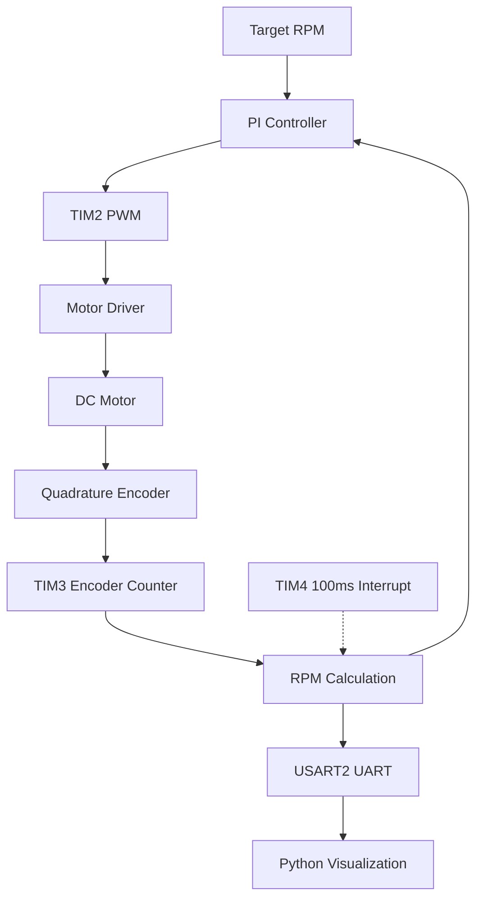

# STM32 Bare-Metal DC Motor Speed Control

A closed-loop DC motor speed control system built on the STM32 NUCLEO-F446RE using register-level programming. 

The project integrates PWM generation, quadrature encoder feedback, PI control, and UART telemetry for real-time motor speed monitoring and regulation.

## Features
- **Hardware PWM:** Generates a 1 kHz PWM signal using TIM2 Channel 1 to control motor speed.
- **Quadrature Encoder:** Configures TIM3 in Encoder Mode 3 to decode encoder signals and calculate motor speed.
- **Timer Interrupts:** Uses TIM4 to generate periodic interrupts every 100 ms for motor speed sampling.
- **PI Controller:** Implements a PI control algorithm with anti-windup to regulate motor speed based on encoder feedback.
- **UART telemetry:** Sends motor speed and PWM duty cycle data via USART2 for real-time visualization using Python.

## Hardware Components
| Component | Purpose |
|---|---|
| STM32 NUCLEO-F446RE | Microcontroller |
| DC Gearmotor with Encoder | Motor actuation and speed feedback |
| TB6612FNG Motor Driver | Drives the motor using PWM and direction signals |
| External Power Supply | Provides power to the DC motor |

## Pin Assignments
| STM32 Pin | Function |
|---|---|
| PA5 | TIM2 CH1 - PWM Output |
| PA6 | TIM3 CH1 - Encoder A |
| PA7 | TIM3 CH2 - Encoder B |
| PA8 | Motor Direction Input 1 |
| PA9 | Motor Direction Input 2 |
| PA2 | USART2 TX |

## System Architecture

## Implementation

### Hardware PWM
TIM2 Channel 1 is configured in PWM Mode 1 to generate a 1 kHz PWM signal. The duty cycle is controlled by updating the CCR1 register, allowing PWM to generate without continuous CPU intervention. 

### Encoder Feedback & RPM Calculation  
TIM3 Channel 1 and Channel 2 are configured in Encoder Mode 3 to decode quadrature signals from the motor encoder. The encoder count is sampled every 100 ms using TIM4. Motor speed is calculated using the change in encoder counts over the sampling interval. 
$$
RPM = \frac{\Delta count}{CPR} \times \frac{60}{\Delta t}
$$

### PI Speed Control
A PI controller regulates motor speed based on the error between target RPM and measured RPM. The controller combines proportional and integral terms to calculate the PWM duty cycle.

Conditional integration anti-windup is implemented to prevent excessive integral accumulation when the control output reaches its limits.
$$
e_k = r_k - y_k
$$
The integral term is updated as:
$$
I_k = I_{k-1} + e_k \Delta t
$$
The control output is calculated as:
$$
u_k = K_p e_k + K_i I_k
$$
The PI controller was tuned empirically by repeatedly adjusting the proportional and integral gains and observing the motor's response using real-time Python visualization.

The tuning process focused on balancing response speed, overshoot, oscillation, and steady-state tracking accuracy.

The final gains were:
K_p = 0.005
K_i = 0.010

The controller was tested with reference speed changes between 80 RPM and 100 RPM. 

## Experimental Results
The motor speed controller was tested using step changes between 80 RPM and 100 RPM. The measured data was recorded through UART and visualized in real time using Python. An initial speed spike was observed during motor startup. However, subsequent reference changes showed more consistent tracking of the target speed.

The exact cause of the startup spike has not yet been determined and remains a potential area for further investigation.

## Engineering Design and Challenges

### Real-Time Sampling and Execution Time
The TIM4 interrupt service routine (ISR) captures encoder counts every 100 ms, while RPM calculation, PI control, PWM updates, and UART telemetry are handled in the main loop to minimize interrupt execution time.

However, blocking UART transmission could potentially delay main-loop processing, allowing new samples to overwrite unprocessed data and causing inaccurate RPM calculations.

To evaluate this risk, the DWT cycle counter was used to measure the execution time of the complete main-loop processing routine. A sample sequence counter was also implemented to detect skipped samples.

During a 20 second test at a 16 MHz CPU clock, the maximum observed processing time was 2.34 ms, with zero missed samples.

These results demonstrated sufficient timing margin under the tested conditions, supporting the decision to retain the original short-ISR main-loop processing architecture.

### Encoder Counter Wraparound
TIM3 uses a 16-bit counter, which wraps around between 0 and 65535. To handle counter wraparound, the firmware corrects large count differences by adding or subtracting 65536.

This allows the system to calculate signed encoder count changes correctly as long as the count change between two consecutive samples is within half the counter range.

### PI Anti-Windup
When the PWM duty cycle reaches its output limits (0–100%), the integral term of the PI controller may continue accumulating error even though the motor cannot respond to additional control effort. This can lead to integral windup, causing excessive overshoot and delayed recovery.

To address this issue, conditional integration anti-windup was implemented. Integration is suspended when the controller output is saturated and the error would drive it further into saturation. However, integration is still allowed when the error helps bring the output back within its valid range.

## Demo Video
[Watch the Demo](https://youtube.com/shorts/U2Zs505AhiM?feature=share)

## Development Environment
- STM32CubeIDE
- Embedded C (CMSIS, register-level programming)
- Python (pyserial, matplotlib)
- Git / GitHub

## Future Improvements
- **C++ and STM32 HAL:** Transition from bare-metal C to C++ and STM32 HAL to improve code modularity, maintainability, and scalability.
- **Two-Wheeled Car:** Build a differential-drive car with two independently controlled DC motors using closed-loop speed control.
- **Custom 3D-Printed Chassis:** Design a custom chassis in CAD and fabricate it using 3D printing.
- **Stall Detection:** Detect motor stalls using encoder feedback and implement protective responses to prevent prolonged motor overload.
- **Custom PCB:** Design a dedicated motor control PCB using KiCad to integrate the microcontroller, motor drivers, and supporting circuitry.